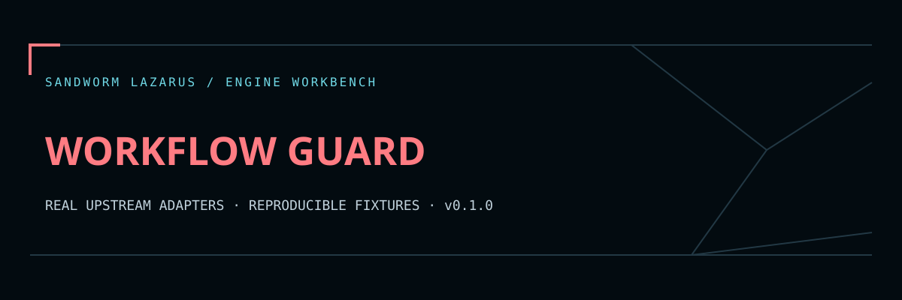

# Sandworm Workflow Guard



Read-only GitHub Actions audits powered by **zizmor 1.32.0**. Sandworm adds explicit local-file selection, bounded offline execution, snippet-free reports, baseline deltas, one-based source coordinates and Thai remediation guidance.

ตรวจ workflow ที่เลือกด้วย engine จริง พร้อมคำแนะนำภาษาไทย และเทียบผลก่อน–หลังแก้ไข รายงานที่ส่งออกไม่คัดลอกโค้ด workflow, secret หรือชื่อไฟล์ต้นฉบับ ไม่มีการแก้ไฟล์ให้อัตโนมัติ

## Quick start / เริ่มใช้งาน

Python 3.11+ on Linux. Importing existing JSON requires only the standard library. Install the pinned upstream wheel in an isolated environment:

```bash
python -m venv .venv
.venv/bin/python -m pip install -r requirements-tools.txt
python guard.py scan examples workflows/unsafe.yml --output before.json
python guard.py scan examples workflows/safe.yml --baseline before.json --output after.json
python guard.py import examples/upstream.json --output imported.json
python scripts/validate.py
```

Use `--binary /absolute/path/to/zizmor` when the executable lives elsewhere. The worker verifies the exact upstream version, invokes without a shell and enforces Linux process bounds. Outputs are exclusively created; pick a new output path for each run. No token or external model is required.

## What is scanned

Provide a **local root directory plus 1–64 explicitly selected relative YAML files**. Each file is at most 256 KiB; total selected input is at most 2 MiB. Absolute paths, traversal segments, backslashes, duplicate selections and symlinks are rejected.

The selected files are copied into a temporary tree preserving their relative layout. The worker runs `zizmor --offline --no-config --strict-collection --no-exit-codes --format=json-v1 -- ...` against only those copies. It neither loads repository config nor inherits GitHub tokens. Online-only audits are intentionally unavailable. Zizmor does not execute workflows, and this wrapper never uses `--fix`.

The bundled unsafe workflow is inert test data under `examples/`, not an enabled GitHub Actions workflow. The safe fixture changes the injection pattern to an environment variable and narrows permissions. Different fixtures use different file identities; compare the same path in your own before/after snapshots for location-stable results.

## Reports and baseline comparison

- `schema_version: 1`, exact project slug and explicit `live`, `import` or `fixture` mode.
- Fixed reviewed rule labels and Thai guidance, severity/confidence, 1-based line and column coordinates.
- File identity = SHA-256 of the upstream path; finding identity = SHA-256 of rule, path and **0-based** upstream coordinates. These are integrity/equality markers, not anonymization against guessing.
- No raw `desc`, `feature`, annotation, URL, source path or workflow snippet is exported. Unknown rule labels are represented as `unclassified-rule`, while hashed IDs retain separate identities.
- `new_ids`, `resolved_ids` and `unchanged` compare exact occurrence identities. Moving a line creates a new occurrence. Severity-only changes do not change location identity; inspect current findings too.
- Strict JSON importer: at most 4 MiB / 5,000 findings; duplicate keys, non-finite numbers, foreign schemas and malformed local locations fail closed.

The importer supports **zizmor json-v1 arrays**, not SARIF or future schemas. Baselines are unsigned reports; do not treat attacker-supplied baselines as authoritative policy. Source digests and line numbers can still disclose information about a small known input. See [SECURITY.md](SECURITY.md).

Imports/fixtures record the supported parser version, not an assertion about the source engine: `version` and `network` remain null, and `version_verified` is false. Live runs record the binary version after checking it and mark the worker's enforced offline mode.

## Tests / การตรวจซ้ำ

```bash
python -m unittest discover -s tests -v
python scripts/validate.py
```

Regression coverage includes exact coordinate conversion, primary location selection, sanitized export, changed findings, malformed JSON, path traversal/option injection, symlinks, file caps, suppressed engine errors and a real pinned zizmor unsafe/safe comparison. Live tests are explicitly skipped if the engine is absent; `reports/validation.json` records counts and SHA-256 source/fixture manifest.

The `web/` viewer opens normalized reports and a clearly labelled synthetic example. It never invokes the scanner. Actual auditing requires the worker above.

## License and provenance

Original integration code is MIT. Zizmor is a separately installed MIT tool; its author/contributor attribution remains upstream. No upstream source or executable is vendored. See [THIRD_PARTY_NOTICES.md](THIRD_PARTY_NOTICES.md), [upstream.lock.json](upstream.lock.json) and [docs/DEVELOPMENT.md](docs/DEVELOPMENT.md).

## Sandworm report workspace

The original Sandworm navy/coral theme is included in `web/`. Read [the viewer guide](docs/WEB_VIEWER.md) for local serving, normalized JSON import and export, and [verification scope](docs/BROWSER_QA.md) for the browser QA limit. Run `node --test tests/web.test.cjs` alongside the engine checks above. No worker or scheduler is deployed by opening this static viewer.

The cloud development and upstream smoke checks are reproducible from this repository. A continuously running service needs your own worker/server, authentication, job limits and operational setup. Public source contains synthetic fixtures; local dependencies, secrets, scan targets, model caches and databases are excluded.

Original Sandworm code is MIT-licensed. Upstream engines retain their respective licenses and credit; embedded fonts use OFL with notices in `web/fonts/`.
